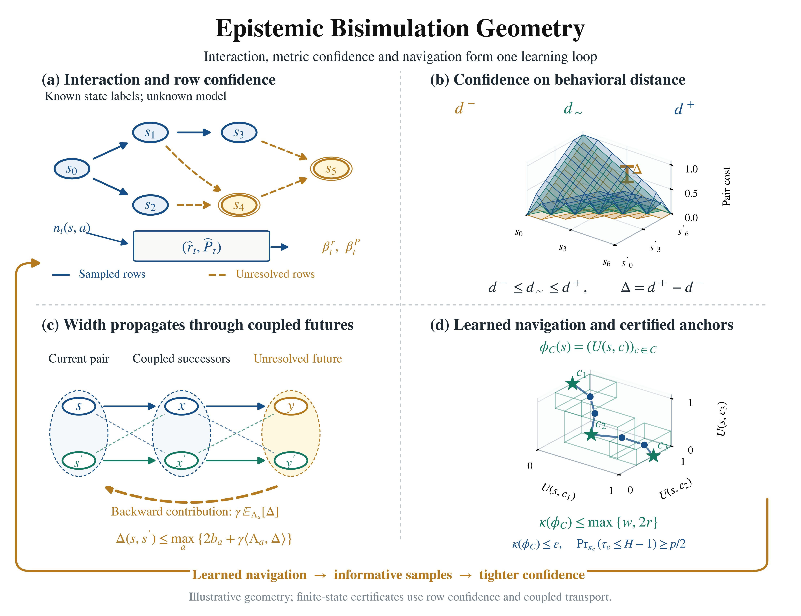
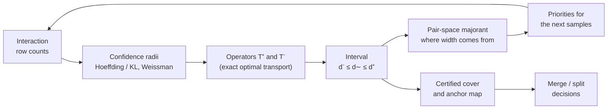
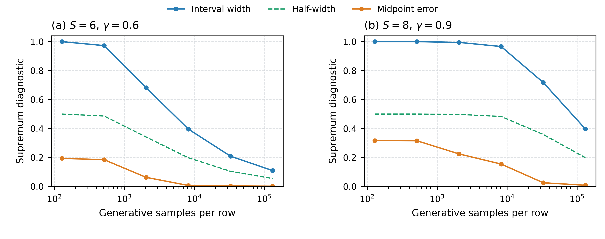
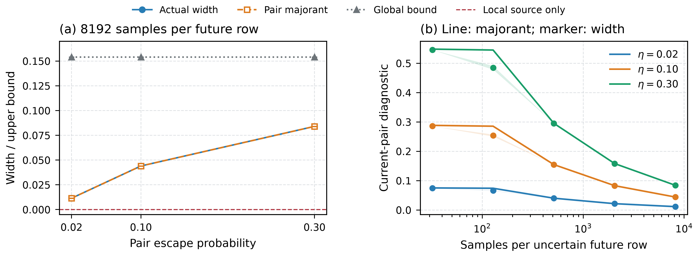

<div align="center">

# Epistemic Bisimulation Geometry

### *Know what you don't know about behavioral distance.*

**Finite-state certificates for representation and exploration in reinforcement learning**


[](paper/epistemic_bisimulation_geometry.pdf)
[](https://doi.org/10.1109/ACCESS.2026.3743463)



</div>

---

## The idea in thirty seconds

A bisimulation metric tells an agent which states *behave* alike, which makes it a natural
geometry for exploration and representation learning. There is a catch: the metric is only
known once the environment has been explored, and exploring well needs the metric.

This repository accompanies a paper ([PDF](paper/epistemic_bisimulation_geometry.pdf)) that breaks the circle by treating the metric as an
object of **statistical uncertainty**. Instead of a single estimate, every pair of states
gets an interval that is guaranteed, with probability at least $1-\delta$ and at every
moment of learning, to contain the true distance:

$$
d_t^-(s,s') \;\le\; d_\sim(s,s') \;\le\; d_t^+(s,s').
$$

The width of that interval obeys its own Bellman inequality on pairs of states, so
uncertainty flows *backwards* from unresolved futures, and a computable majorant turns it
into a certificate. The upper endpoint then yields certified covers and anchor
representations with explicit distortion.



---

## What the experiments found

Every number below comes from the seed-level records in [`results/`](results) and can be
re-derived with the scripts in [`code/`](code).

| | Finding |
|---|---|
| **Validity** | The certified intervals covered the true metric at every pair in every recorded run: 1000 V1 runs, 400 + 1200 V6 runs, and 100 RiverSwim runs. |
| **Sharper, for free** | A diameter refinement on the *same* confidence event narrowed the intervals up to **7×** on RiverSwim (0.292 → 0.042). |
| **Decisions** | Certified merge/split decisions made **zero** errors, while a bootstrap band built from the same samples wrongly separated bisimilar states in **63–87 %** of runs. |
| **Compression** | 128 labels collapsed to **4** anchor coordinates in every run, with distortion at most 0.063. |
| **Navigation** | Learned optimistic navigation needed **34×** fewer steps than random navigation on RiverSwim. |
| **Targeted queries** | Influence (adjoint) priorities answered "are these two states distinct?" with **24 %** less interaction on the corridor, and with no detectable saving on RiverSwim. |
| **Honest negatives** | Forward-propagated priorities added nothing detectable; the neural extension learns a partly invariant encoder but not yet informative uncertainty. |

<p align="center">
  
  
</p>

---

## Quick start

```bash
git clone https://github.com/Adityasikarwar3107/epistemic-bisimulation-geometry.git
cd epistemic-bisimulation-geometry
python -m pip install -r requirements.txt
python -m pip install -r requirements-neural.txt   # optional, for V11 and one check

python code/verify_results.py                     # 19 checks, about half a minute
```

`verify_results.py` re-runs the proof constructions and solver cross-checks, then checks
every stored record against the SHA-256 hashes in its run manifest and confirms that the
released code is the code that produced it (see [Provenance](#provenance)).

## Reproducing the eleven studies

Each study writes into its own folder under `results/`. Its configuration is frozen in
`experiment_spec.json` before anything runs, and a run refuses to start if the code's
specification differs. Times are for an 8-core laptop CPU.

| Study | Question | Command | Time |
|---|---|---|---|
| V1 | Are the intervals valid; is the anchor map accurate? | `python code/run_verified_study.py --part calibration` | ~6 min for V1–V4 |
| V2 | Does the majorant localize inherited width? | `python code/run_verified_study.py --part propagation` | (included) |
| V3 | Navigation or priorities: what sets acquisition cost? | `python code/run_verified_study.py --part ablations` | (included) |
| V4 | How large are the two-clock budgets? | `python code/run_verified_study.py --part budgets` | (included) |
| V5 | What does a certificate cost against other intervals? | `python code/run_extended_study.py --part baselines` | ~80 min |
| V6 | Do coverage and compression persist up to 128 labels? | `python code/run_extended_study.py --part scaling` | ~15 min |
| V7 | Do priorities improve the anytime certificate? | `python code/run_extended_study.py --part anytime`<br>`python code/run_extended_study.py --part anytime_posthoc` | ~20 min<br>~60 min |
| V8 | How much do refinements narrow the intervals? | `python code/run_extended2_study.py --part v1`<br>`python code/run_extended2_study.py --part v6` | ~3 min<br>~5 h |
| V9 | Does the picture hold on RiverSwim? | `python code/run_extended2_study.py --part riverswim`<br>`python code/run_extended2_study.py --part navigation` | ~3 h<br>~15 min |
| V10 | Do adjoint priorities help, overall or for one query? | `python code/run_extended2_study.py --part priorities`<br>`python code/run_extended2_study.py --part targeted` | ~2 h<br>~1 min |
| V11 | What does the neural instantiation achieve? | `python code/run_neural_study.py`<br>`python code/neural_bias_floor.py` | ~15 min<br><1 min |

After rerunning V5–V7 or V8–V10, refresh the manifest with `--part manifest`. Tables, figures
and manuscript macros are rebuilt from the stored records by:

```bash
python code/plot_verified_study.py        # V1–V4 figures and tables
python code/tabulate_extended_study.py    # V5–V7
python code/tabulate_extended2_study.py   # V8–V11
python code/tabulate_compact_tables.py    # merged tables used in the manuscript
```

> Rerunning a study overwrites its folder. Every sampling stream is seeded, so the per-seed
> CSV and NPZ records are regenerated exactly; we confirmed this byte for byte for V1–V4 and
> the V10 targeted query, and `git diff` shows it for any study you rerun. Summary fields
> that record wall-clock time, and the manifest itself, will naturally differ.

## Repository map

```
code/
  ebg.py                 reference operators, planners and quotas
  finite_batch.py        vectorized exact transport, two successors per row
  finite_general.py      exact transport, three successors; refined endpoints
  neural_primitives.py   width critic, surrogate endpoints, representation loss
  run_*_study.py         the eleven studies
  plot_*/tabulate_*.py   figures, tables and macros from stored records
  verify_results.py      the 19 checks
  theory_checks.py       deterministic checks of the proof constructions
results/
  verified/   V1–V4      extended/   V5–V7      extended2/   V8–V10
  neural/     V11        compact/    merged manuscript tables
  code_provenance.json
figures/      result figures (PDF and PNG)
```

<details>
<summary><b>What is inside a results folder?</b></summary>

| File | Content |
|---|---|
| `experiment_spec.json` | Frozen configuration and seed lists, written before execution |
| `run_manifest.json` | Package versions, SHA-256 of the specification, code, and every result file |
| `*.csv` | One row per seed, checkpoint, and method; nothing is aggregated away |
| `calibration_*_n*.npz` | V1 empirical models, sufficient statistics, true metric, endpoints, and majorants |
| `summary*.json` | Means, bootstrap intervals, and paired contrasts computed from the CSV files |
| `*_rows.tex`, `summary_macros.tex` | Manuscript tables and numbers derived from the above |

</details>

## Provenance

Results were produced before the code was tidied for release. The tidy-up removed
docstrings and comments only, with one exception: `budgets()` in `run_verified_study.py`
no longer writes an internal audit of an earlier draft, and the V4 budgets it produces are
unchanged. [`results/code_provenance.json`](results/code_provenance.json) records, for every
file named in a manifest, the hash of the code that ran, the hash of the released file, and
a fingerprint of their syntax trees with docstrings removed. `verify_results.py` checks all
three. Rerunning V1–V4 and the V10 targeted query with the released code reproduces the
stored records byte for byte.

Two analyses were designed after seeing results and are labeled post hoc in the paper and
in the code: the tie-breaking rerun of V7 and the target-bias diagnostic of V11. The pilot
that set the V7 quota used one seed that is also among the reported V7 runs; the pilots that
fixed the designs of V9 and V10 used seeds outside the reported ranges.

## Scope

The guarantees are for finite MDPs with known state labels, under the confidence event of
the paper. The experiments are simulations: synthetic finite MDPs, RiverSwim, and a
synthetic rich-observation block MDP. The neural extension is evaluated, not certified.

## Citation

```bibtex
@unpublished{gupta2026epistemic,
  title  = {Epistemic Bisimulation Geometry: Finite-State Certificates for
            Representation and Exploration},
  author = {Gupta, Deepak and Gupta, Pranda Prasanta and Sikarwar, Aditya and
            Dhangar, Sanidhya and Sharma, Akhilesh Kumar and Abrayev, Bakhrom and
            Ashirova, Anorgul},
  year   = {2026},
  note   = {Manuscript}
}
```

This work builds on our companion paper:

```bibtex
@article{gupta2026bisimulation,
  title   = {Bisimulation Geometry: Unifying Representation Learning and
             Exploration in Reinforcement Learning},
  author  = {Gupta, Deepak and Sikarwar, Aditya and Dhangar, Sanidhya and
             Jha, Chanakya Kumar and Jha, Pallavi and Sharma, Akhilesh Kumar and
             Abdullayev, Vugar},
  journal = {IEEE Access},
  year    = {2026},
  doi     = {10.1109/ACCESS.2026.3743463}
}
```

## License

Code: [MIT](LICENSE). Results and figures: [CC BY 4.0](LICENSE-DATA).
